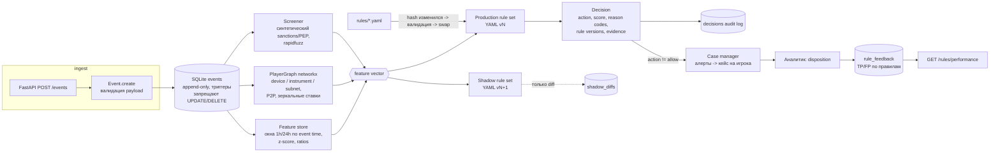

# fraud-rules-engine

Объяснимый risk decisioning для платежей и аккаунтов в iGaming, построенный на event sourcing. Каждое событие (регистрация, KYC, депозит, вывод, chargeback, логин, бонус, ставка, P2P-перевод) сначала пишется в append-only лог, затем проходит через потоковые признаки, граф устройств и платёжных инструментов, sanctions/PEP-скрининг и версионируемые YAML-правила. На выходе получается решение `allow / review / step_up_kyc / block`. В решении записаны reason codes, версия rule set и значения признаков, из-за которых сработали правила.

Все данные синтетические и обезличенные. Проект показывает архитектуру и аналитику, а не готовую AML-систему.

**Стек:** Python 3.12, uv, SQLite (event store и audit log), FastAPI, PyYAML (rule DSL), networkx (device/payment graph), rapidfuzz (fuzzy name matching), NumPy (PSI и кривые порогов), pytest, ruff, GitHub Actions, Docker (опционально).

## Быстрый старт

```bash
uv sync
uv run pytest                      # 50 тестов, ~40 с
uv run ruff check

# синтетическая популяция -> движок -> кейсы -> метрики -> reports/summary.md
uv run fre simulate                # --players 2000 --seed 7 по умолчанию

# проверка rule set (то же выполняется при hot-reload)
uv run fre validate rules/production.yaml rules/candidate.yaml

# API (SQLite-файл; после рестарта состояние восстанавливается из лога)
uv run fre serve --db fre.sqlite
curl -X POST localhost:8000/events -H 'content-type: application/json' -d '{
  "event_id": "d1", "type": "registration", "player_id": "u42", "ts": 1767225600,
  "payload": {"name": "BRENNHOLT Oskar", "dob": "1980-01-30", "country": "XA",
              "device_id": "dev1", "ip": "10.0.0.7"}}'
# -> {"action":"block","reasons":[{"rule_id":"SANCTIONS_HIT","rule_version":1,
#     "reason_code":"SANCTIONS_LIST_HIT",...}],"ruleset_version":"2026.09.1",
#     "evidence":{"sanctions_score":100.0,...},"shadow":{...}}
```

Docker: `docker compose up --build`. Каталог `rules/` монтируется read-only, поэтому правка YAML на хосте подхватывается hot-reload. Для тестов Docker не нужен.

| Метод | Путь | Что делает |
|---|---|---|
| POST | `/events` | принимает событие, возвращает решение с reason codes (409 на дубликат `event_id`, 422 на невалидный payload) |
| GET | `/cases?status=open` | очередь кейсов по приоритету |
| POST | `/cases/{id}/assign` | назначить аналитика |
| POST | `/cases/{id}/disposition` | `fraud` / `not_fraud`, закрывает кейс и обновляет статистику правил |
| GET | `/rules/performance` | precision по правилам из решений аналитиков, число алертов, число shadow-расхождений |
| GET / POST | `/rules`, `/rules/reload` | активные версии, ручной reload |

## Архитектура



Отдельные модули, которые работают на тех же данных:

- `routing.py`: выбор PSP по оценке approval rate и стоимости, circuit breaker по доле технических ошибок, failover, сверка settlement-файла PSP с внутренним леджером;
- `metrics.py`: precision/recall/FPR по правилам на ground truth, expected value ручной проверки, кривая approval rate против fraud loss, PSI drift;
- `simulate.py` и `report.py`: генератор синтетической популяции и end-to-end прогон, который пишет `reports/summary.md`.

## Rule DSL

```yaml
ruleset: production
version: "2026.09.1"
thresholds: {review: 50, block: 90}     # эскалация по сумме score, тоже с reason code

rules:
  - id: CARD_TESTING
    version: 3
    description: Burst of failed deposits with many cards or micro amounts
    when:
      event: deposit_attempt             # или список типов событий
      all:
        - "failed_deposits_1h >= 3"
        - any: ["distinct_instruments_24h >= 3", "amount <= 5"]
    action: block                        # allow | review | step_up_kyc | block
    severity: high
    reason: CARD_TESTING_PATTERN
    score: 60

  - id: CASH_CYCLING
    description: Deposit -> withdrawal within 24h with almost no wagering (AML typology)
    when:
      event: withdrawal_request
      all: ["wagering_ratio < 0.3", "minutes_since_last_deposit < 1440"]
    action: review
    severity: high
    reason: CASH_CYCLING_LOW_WAGERING
    score: 40
```

Условие задаётся строкой `"<feature> <op> <value>"` или словарём `{feature, op, value}`. Их можно комбинировать через `all`, `any` и `not`. Доступные операторы: `> >= < <= == != in not_in between`. При загрузке валидатор проверяет:

- что признак есть в реестре (`features.FEATURE_REGISTRY`, 28 признаков);
- что тип признака подходит оператору;
- типы значений, уникальность `id`, допустимые action, severity и event type;
- формат reason code (UPPER_SNAKE_CASE).

Опечатка в имени признака роняет reload. Без такой проверки правило молча перестало бы срабатывать в production.

Полные rule set: [`rules/production.yaml`](rules/production.yaml) (19 правил) и [`rules/candidate.yaml`](rules/candidate.yaml). Candidate работает в shadow mode и отличается от production четырьмя изменениями: card testing срабатывает уже на двух отказах, ring срабатывает от двух аккаунтов, порог cash cycling поднят до 0.5, добавлено правило `BONUS_RING`.

## Ключевые решения

- **События как источник истины.** В таблицу `events` можно только добавлять: SQLite-триггеры отклоняют `UPDATE` и `DELETE`. Проекции (`projections.py`) и всё in-memory состояние движка пересобираются из лога. `DecisionEngine.rehydrate()` восстанавливает состояние после рестарта API без повторной записи решений и алертов.
- **Детерминированный replay.** Окна считаются по времени события, а не по wall clock. В движке нет случайности, и решения не зависят от предыдущих решений. Повторный прогон лога через свежий движок даёт побитово те же решения; это проверяют тесты и каждый прогон симуляции. Через `replay` же делается back-test candidate-правил на истории.
- **Объяснимость в каждом решении.** В решении записаны `ruleset@version`, для каждого сработавшего правила `rule_id`, `rule_version`, `reason_code`, `severity` и `score`, а также `evidence` (значения признаков из условий этих правил). Эскалация по сумме score оформлена как псевдоправило `SCORE_GE_90`, чтобы у неё тоже была причина.
- **Hot-reload с защитой.** Файл перечитывается, только если изменился его sha256. Невалидный файл не заменяет рабочий rule set: старый остаётся активным, ошибка видна в `GET /rules`.
- **Shadow mode.** Candidate-правила вычисляются на том же векторе признаков. На ответ они не влияют; в `shadow_diffs` пишутся только расхождения в action или reason codes.
- **Сильные и слабые связи в графе.** Общий device или платёжный инструмент объединяет аккаунты в компоненту (оценка multi-accounting ring). Общая /24 подсеть только считается и компоненты не объединяет: за NAT и у мобильных операторов сидят тысячи честных игроков.
- **Сговор определяется по форме ставок.** Противоположная ставка связанного игрока засчитывается, только если она сделана в пределах часа и с похожей суммой (±20%). В первой версии без этого фильтра правило давало 25 ложных срабатываний на семьях с общим планшетом, которые ставят на одни и те же матчи.
- **Скрининг.** Имена нормализуются (Unicode, диакритика, пунктуация), затем считается `token_sort_ratio`, поэтому перестановка «Фамилия, Имя» не мешает совпадению. Если дата рождения не совпадает, из score вычитается 15. Пороги заданы явно: ≥90 hit, 80–90 potential match на ручную проверку. Совпадение с PEP означает EDD (`step_up_kyc`), а не блокировку, и PEP не считается фродом.
- **Routing.** Провайдер выбирается по `p_approve × amount − fee(amount)`, где `p_approve` — Beta-сглаженная доля одобрений за скользящее окно. Технические ошибки идут в circuit breaker (closed → open → half-open с пробным запросом) и вызывают failover. Отказ банка-эмитента окончательный: его не повторяют на другом PSP, иначе для эмитента это похоже на card testing.
- **Feedback loop без ground truth.** Precision в `/rules/performance` считается только по решениям аналитиков. В симуляции у аналитиков 5% ошибок разметки, и видно, насколько онлайн-оценка расходится с офлайн-метриками по ground truth.

## Результаты (синтетика, `fre simulate`, seed 7)

Популяция: 2 000 честных игроков и 204 мошенника семи типов (multi-account rings, bonus abusers, card testers, chargeback fraud, collusion pairs, cash cycling, совпадения с санкционным списком), 30 дней, **100 323 события**. Полный отчёт лежит в [`reports/summary.md`](reports/summary.md).

| Метрика | Значение |
|---|---|
| Deterministic replay | 100 323 из 100 323 решений идентичны |
| Precision / recall / FPR по игрокам (любое не-`allow`) | 65.7% / 79.9% / 4.2% |
| Recall по сегментам | card testers 100%, sanctioned 3/3, chargeback 93%, cash cycling 85%, collusion 80%, rings 73%, bonus abusers 65% |
| Доля синтетического loss у отмеченных игроков | 95.4% |
| Shadow candidate (back-test) | precision 57.6%, recall 85.3%, FPR 6.4%; 133 события с расхождениями |
| Кривая порога score | порог 10: legit approval 98.4%, пропущено 60% fraud-linked суммы; порог 35: legit approval 100%, пропущено 80% |
| PSI drift | `amount` 0.29 (alert на инжектированный сдвиг ×1.6); `account_age_hours` 0.72 (структурный дрейф, см. отчёт) |
| Outage PSP (90% ошибок на 2 дня) | naive: approval 84.1%, 394 ошибки у клиентов; smart + breaker + failover: 92.1%, 0 ошибок, комиссия 264 bps против 190 |
| Сверка settlement | найдено 59 расхождений из 59 внесённых (missing 22, amount 17, status 13, duplicate 4, unknown 3) |
| Латентность решения (in-process, SQLite in-memory, ноутбук) | p50 ≈ 0.3 мс, p99 ≈ 0.7 мс, ~3 000 событий/с в одном потоке; число сильно зависит от загрузки машины |

Что показывают цифры:

- Самый высокий EV ручной проверки у `AMOUNT_SPIKE`, при precision всего 38%. Chargeback-потери крупные, и одна пойманная схема окупает десятки проверок по 15 у.е. Выводы по правилам нужно делать по EV, а не по одной precision.
- Candidate поднимает recall на 5.4 п.п. ценой 2.2 п.п. FPR. Метрики shadow дают данные для решения о выкатке, но само решение остаётся за человеком.
- Score как один порог работает слабо: основную работу делают действия конкретных правил. Кривая показывает цену дополнительной чувствительности: 1.6% отказов честным игрокам снижают долю пропущенной fraud-linked суммы с 80% до 60%.
- Recall 100% на card testers получается потому, что синтетические card testers «учебные». На реальных данных это число будет ниже.

## Ограничения

- **Реальных персональных данных нет.** Игроки, имена, устройства, карты, IP, провайдеры и суммы сгенерированы. Watchlist (`data/watchlist_synthetic.csv`, 13 записей с префиксом `SYN-`) придуман и не содержит реальных людей и реальных санкционных списков.
- **Это не сертифицированная AML/CTF-система.** Проект не заменяет лицензированного провайдера скрининга, transaction monitoring и работу MLRO и не обещает соответствия требованиям какого-либо регулятора.
- **Это не юридическая консультация.** Названия типологий (cash cycling, collusion, PEP EDD) взяты для иллюстрации. Реальные пороги и процедуры определяют compliance-команда и юристы юрисдикции.
- Метрики получены на синтетике, где схемы фрода заданы генератором. Они показывают, что механизмы работают, но не говорят, какой detection rate будет в реальном продукте. Loss-величины условные (см. docstring в `simulate.py`).
- Движок однопоточный, состояние признаков живёт в памяти одного процесса. Для production нужны партиционирование по игроку, внешний feature store, snapshotting состояния, вынос reload и review в отдельные сервисы, аутентификация API и RBAC для аналитиков.
- Модели нет: score складывается из весов правил. Следующий шаг — интерпретируемая модель (например, GBM с reason codes через SHAP), обученная на dispositions. Для неё нужны реальные размеченные кейсы.

## Тесты

`uv run pytest`: 50 тестов. Что они проверяют:

- event store: запрет UPDATE/DELETE, дубликаты, порядок, проекции;
- DSL: парсинг, 12 классов ошибок валидации, эскалация по порогам, hot-reload с откатом на последнюю валидную версию, promote shadow;
- окна по event time, z-score, cross-player признаки, граф (ring, subnet, зеркальные ставки);
- скрининг: перестановки, опечатки, штраф за DOB;
- движок: reason codes и версии в решениях, shadow без влияния на ответ, детерминированный replay, rehydrate после рестарта;
- кейсы: группировка алертов, очередь, feedback, ошибки;
- routing: жизненный цикл breaker, failover только на ошибках, outage;
- reconciliation: все пять типов расхождений;
- метрики: PSI, кривая порогов, EV;
- API: полный цикл событие → кейс → disposition → performance, 409/422/404, hot-reload через API;
- end-to-end симуляция и CLI.

CI (`.github/workflows/ci.yml`): `uv sync --locked`, `ruff check`, `ruff format --check`, `pytest`, валидация rule set и smoke-прогон симуляции.

## Как это соотносится с вакансией

| Требование в вакансиях (gaming fraud analyst, payments engineer, risk & AML analyst, compliance tooling) | Где в репозитории |
|---|---|
| Velocity rules, device fingerprinting, multi-accounting, bonus abuse | `features.py`, `graph.py`, `rules/production.yaml` |
| Chargebacks, card testing, payment fraud | правила `CARD_TESTING`, `AMOUNT_SPIKE`, `PRIOR_CHARGEBACK` |
| AML-типологии: cash cycling, P2P, collusion, sanctions/PEP screening | `CASH_CYCLING`, `P2P_FANOUT`, `COLLUSION_OPPOSITE_BETS`, `screening.py` |
| Payment routing, PSP failover, approval rate, reconciliation | `routing.py`, раздел отчёта про outage и сверку |
| Case management, review queue, analyst feedback | `cases.py`, `/cases`, `/rules/performance` |
| Precision/recall алертов, FPR, EV ручной проверки, approval rate против fraud loss | `metrics.py`, `reports/summary.md` |
| Monitoring и drift | PSI в `metrics.py` |
| Traceability и audit trail | append-only лог, решения с версиями правил и evidence, deterministic replay |
| Compliance tooling: безопасная выкатка правил | валидация DSL, hot-reload с откатом, shadow mode и back-test |

## Лицензия

MIT, © 2026 Nikolay Chekotko.
